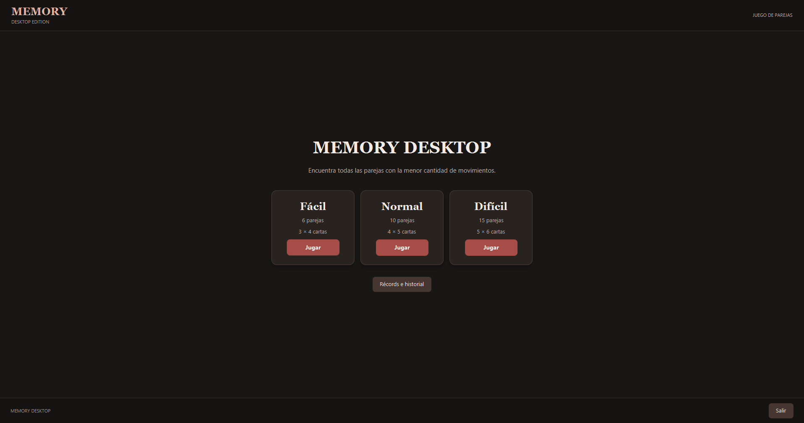
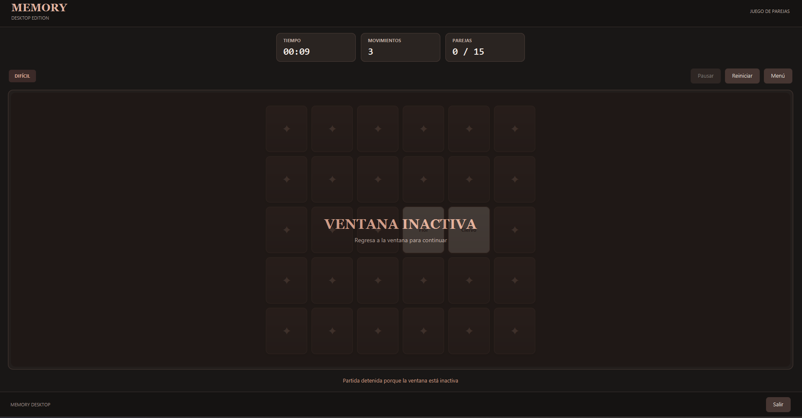
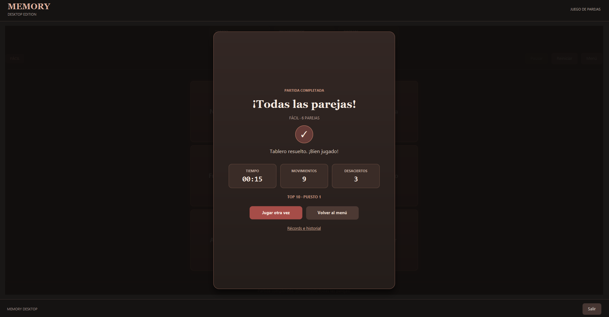
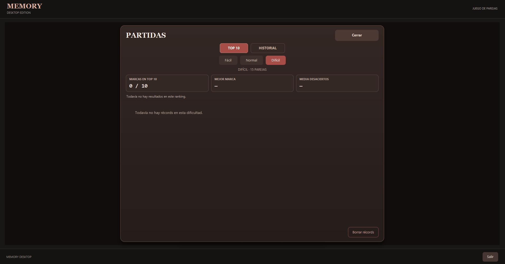
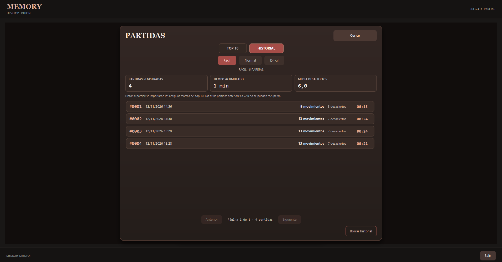

# MEMORY DESKTOP

[](https://github.com/cgaraydev/memory-desktop/actions/workflows/ci.yml)


**Memory Desktop** es un juego de memoria para escritorio desarrollado en **Java 25 y JavaFX**. El objetivo es encontrar todas las parejas de cartas con la menor cantidad de movimientos posible.

El proyecto forma parte de mi portafolio de desarrollo de software. Combina lógica de juego independiente de la interfaz, animaciones, persistencia local, pruebas automatizadas e integración continua.

## Capturas de pantalla

| Menú principal | Partida en curso |
| :---: | :---: |
|  |  |

| Partida completada | Récords |
| :---: | :---: |
|  |  |



## Funcionalidades

- **Tres dificultades:** Fácil (6 parejas, tablero 3 × 4), Normal (10 parejas, 4 × 5) y Difícil (15 parejas, 5 × 6).
- **Tablero adaptable:** las cartas ajustan su tamaño al espacio disponible.
- **Animaciones:** volteo de cartas, confirmación de parejas, entrada del tablero y transiciones entre pantallas.
- **Temporizador y movimientos:** seguimiento del tiempo transcurrido, los intentos y las parejas encontradas.
- **Pausa manual y automática:** detención del juego al pausar o perder el foco de la ventana; la pausa manual también puede reanudarse pulsando el área del tablero.
- **Pantalla de resultados:** duración, movimientos y desaciertos al completar una partida.
- **Récords locales:** top 10 independiente para cada dificultad, ordenado por menor número de movimientos y, en caso de empate, menor tiempo.
- **Historial:** registro de partidas terminadas aunque no entren en el top 10, con estadísticas acumuladas y navegación paginada.
- **Uso sin conexión:** no requiere cuentas ni servicios externos para jugar o guardar resultados.

## Tecnologías

| Tecnología | Uso |
| --- | --- |
| Java 25 | Lógica del juego y aplicación de escritorio |
| JavaFX 25.0.5 | Interfaz, animaciones y gestión de ventanas |
| FXML y JavaFX CSS | Estructura y estilos visuales |
| Maven + Maven Wrapper | Compilación y dependencias |
| Jackson 2.22.3 | Persistencia JSON de récords e historial |
| JUnit 5 | Pruebas unitarias |
| GitHub Actions | Compilación y pruebas en cada push o pull request a `main` |

## Organización del código

El código está organizado de forma que la lógica de las partidas no dependa de JavaFX:

```text
src/
├── main/
│   ├── java/com/cgaraydev/memory/
│   │   ├── application/  # Coordinación de partidas, reloj y resultados
│   │   ├── domain/       # Cartas, tablero, motor, fases y temporizadores
│   │   ├── records/      # Rankings, historial, estadísticas y persistencia
│   │   ├── ui/           # Controlador, dimensionado y animaciones JavaFX
│   │   └── App.java      # Punto de entrada
│   └── resources/com/cgaraydev/memory/ui/
│       ├── memory.fxml
│       └── memory.css
└── test/java/com/cgaraydev/memory/
    ├── application/
    ├── domain/
    ├── records/
    └── ui/
```

El motor valida las selecciones y las resoluciones de parejas; el coordinador gestiona la partida y sus temporizadores; la interfaz representa el estado y maneja las transiciones visuales.

## Requisitos y ejecución

- **JDK 25** instalado y disponible en `JAVA_HOME` o en el entorno.
- No es necesario instalar Maven por separado: el repositorio incluye **Maven Wrapper**.

En Windows (PowerShell):

```powershell
git clone https://github.com/cgaraydev/memory-desktop.git
cd memory-desktop
.\mvnw.cmd clean verify
.\mvnw.cmd javafx:run
```

En Linux o macOS, utilizando un JDK 25 compatible:

```bash
./mvnw clean verify
./mvnw javafx:run
```

> La aplicación se ha probado manualmente en Windows. La compilación y las pruebas automatizadas también se ejecutan en Ubuntu mediante GitHub Actions. No se distribuye todavía un instalador nativo.

## Datos locales

Los resultados se guardan en un archivo JSON fuera del repositorio:

- **Windows:** `%LOCALAPPDATA%\MemoryDesktop\records.json`
- **Otros sistemas:** `~/.memory-desktop/records.json`

El formato actual de datos es **v2**: conserva el top 10 y el historial de partidas. Incluye migración desde el formato anterior de récords (v1) y creación de una copia de seguridad durante dicha migración.

El historial importado desde v1 puede ser parcial, porque las partidas que no entraron en el ranking antiguo no se almacenaban.

## Pruebas e integración continua

El proyecto dispone de **127 pruebas automatizadas** validadas durante el desarrollo, que cubren el motor de juego, temporizadores, coordinación, resultados, récords, historial, persistencia y cálculo de dimensiones del tablero.

Para ejecutar la suite completa:

```powershell
.\mvnw.cmd clean verify
```

El workflow de [GitHub Actions](https://github.com/cgaraydev/memory-desktop/actions/workflows/ci.yml) ejecuta el mismo proceso sobre Ubuntu con Java 25.

## Estado del proyecto

**Versión funcional de portafolio.** Están implementadas las mecánicas de juego, la interfaz animada, las tres dificultades, los récords y el historial local. Entre las posibles mejoras futuras se encuentran nuevas estadísticas, opciones de personalización y el empaquetado como aplicación instalable para Windows.

## Autor

**Camilo Garay Vásquez**  
[GitHub](https://github.com/cgaraydev)
